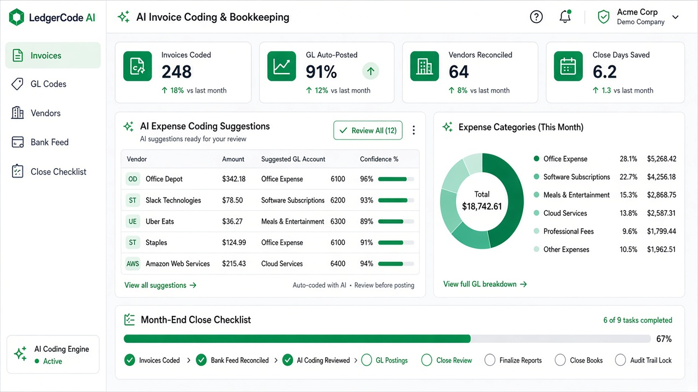

# AI Invoice Coding & Bookkeeping Agent



**SEO title:** AI Invoice Coding & Bookkeeping Agent | Expense Classification, GL Posting, Vendor Reconciliation  
**SEO description:** AI invoice coding and bookkeeping agent that classifies expenses, posts GL codes, reconciles vendors, and cuts accounting close time dramatically.  
**Keywords:** AI invoice coding, expense classification software, GL posting automation, vendor reconciliation, month-end close checklist, bookkeeping agent, Filament Laravel accounting, OCR invoice processing  
**Author:** Imran Ahmed \<me@imrandev.bd\> · [imrandev.bd](https://imrandev.bd)  
**Accent:** `#059669` · **Industry:** Accounting / Bookkeeping  
**Repository:** [github.com/imranbru99/ai-invoice-coding-bookkeeping-agent](https://github.com/imranbru99/ai-invoice-coding-bookkeeping-agent)

---

## Why this product exists

Month-end close still dies in spreadsheets: AP clerks retype invoices, guess GL codes, chase vendor statements, and re-match bank lines until midnight. Mis-coded expenses cascade into audit findings and delayed reporting.

**AI Invoice Coding & Bookkeeping Agent (LedgerCode AI)** is a complete Laravel + Filament business solution that turns AP and close into a modular operating system: invoice OCR, AI expense coding, GL posting, vendor reconciliation, bank feed matching, and close checklists — each module toggleable so startups, mid-market finance teams, and multi-entity groups run only what they need.

### Business ROI & time-saver case

| Bottleneck | Without LedgerCode | With LedgerCode | Typical savings |
|---|---|---|---|
| Invoice data entry | 4–8 min / invoice typing | OCR + structured lines | **3–6 min / invoice** |
| Expense GL coding | Manual chart lookup | AI suggestion + confidence | **2–4 min / line** |
| Vendor reconciliation | Spreadsheet match | Statement vs AP matching | **1–2 hrs / vendor cycle** |
| Bank feed matching | Manual clear | Suggested matches + rules | **30–60 min / day** |
| Month-end close | Scattered checklists | Tracked close tasks | **1–3 days off close** |

For a team processing ~500 invoices/month, reclaiming even **5 minutes per invoice** plus cleaner vendor cycles routinely unlocks **40–80 hours/month** of accounting capacity — before faster close and fewer reclasses.

---

## Product screenshot

The admin dashboard (emerald `#059669` theme) surfaces invoices coded, GL auto-post rate, vendors reconciled, AI coding suggestions, expense mix, and month-end close progress — designed for controllers and AP leads, not generic CRM chrome.

---

## Core modules (all toggleable)

Every module can be enabled/disabled via `.env`, `config/modules.php`, or the **Modules** Filament resource (`module_settings` table). Disabled modules hide from navigation and refuse service-layer execution.

| Module key | Label | What it does |
|---|---|---|
| `invoice_ocr` | Invoice OCR | Capture, parse, and normalize vendor invoices into structured headers and lines |
| `expense_coding` | Expense Coding | AI classification of expenses to chart-of-accounts codes with confidence scores |
| `gl_posting` | GL Posting | Draft and post journal entries from coded invoices |
| `vendor_reconciliation` | Vendor Reconciliation | Match vendor statements to AP activity and flag variances |
| `bank_feed` | Bank Feed | Import bank transactions and suggest invoice/GL matches |
| `close_checklist` | Close Checklist | Month-end close task tracking with owners and due dates |
| `attendance_ops` | Staff Attendance | Optional attendance hub integration (off by default) |

---

## Multi-role users

| Role | Access |
|---|---|
| Super Admin | Full control, modules, users |
| Admin | Finance administration & posting |
| Manager | Oversight, approvals, close ownership |
| Staff | Invoice coding, reconciliations |
| Client / Customer | Portal-only vendor/AP visibility |
| Demo | Seeded showcase user for evaluations |

### Demo credentials (after `db:seed`)

| User | Email | Password |
|---|---|---|
| Demo | `demo@ledgercode.test` | `password` |
| Super Admin | `superadmin@ledgercode.test` | `password` |
| Admin | `admin@ledgercode.test` | `password` |
| Manager | `manager@ledgercode.test` | `password` |
| Staff | `staff@ledgercode.test` | `password` |
| Client | `client@ledgercode.test` | `password` |

---

## Public marketing pages

| Route | Purpose |
|---|---|
| `/` | Hero + live module grid |
| `/features` | Feature deep-dive |
| `/modules` | Toggleable module catalog with ON/OFF status |
| `/pricing` | Starter / Growth / Enterprise framing |
| `/security` | Role, entity-scope, audit posture |
| `/demo` | Demo credentials CTA |
| `/admin` | Filament admin panel |
| `/portal` | Authenticated client / vendor portal |

---

## Technical stack

- **PHP 8.4 / Laravel 13** application core  
- **Filament 5** admin panel (emerald primary `#059669`)  
- **Livewire** interactive admin UI  
- Modular services: `ModuleManager`, `InvoiceOcrService`, `ExpenseCodingService`, `GlPostingService`, `VendorReconciliationService`, `CloseChecklistService`  
- Policies for invoices, vendors, and journal entries  
- Migrations, models, seeders, feature tests  
- Dockerized (`Dockerfile` + `docker-compose.yml`) with MySQL  

### Packagist packages (`imrandevbd/*`)

| Package | Role in this product |
|---|---|
| `imrandevbd/drutogoti` | Performance / speed helpers |
| `imrandevbd/laravel-admin-panel` | Admin panel extensions |
| `imrandevbd/laravel-ai-catalog` | Vendor / catalog enrichment patterns |
| `imrandevbd/laravel-ai-hub` | Multi-provider AI for expense coding |
| `imrandevbd/laravel-attendance-hub` | Optional staff attendance ops |
| `imrandevbd/laravel-unicode-pdf` | Multilingual invoice / statement PDFs |
| `imrandevbd/laravel-universal-slug` | Unicode-safe slugs for vendors & invoices |

> **Note:** On Laravel 13, Packagist builds of `drutogoti`, `laravel-admin-panel`, and `laravel-attendance-hub` currently constrain `illuminate/*` to ^11\|^12. This repo declares all seven packages at `dev-main` and ships L13 path compatibility bridges under `packages/` so the application installs cleanly while upstream catches up. `laravel-ai-hub`, `laravel-unicode-pdf`, and `laravel-universal-slug` install from Packagist. `laravel-ai-catalog` uses a local bridge because Packagist `dev-main` requires `laravel-ai-hub:^1.6` which conflicts with root `dev-main`.

---

## Quick start (local)

```bash
composer install
cp .env.example .env
php artisan key:generate
touch database/database.sqlite   # or configure MySQL
php artisan migrate --seed
php artisan serve
```

- Marketing site: [http://127.0.0.1:8000](http://127.0.0.1:8000)  
- Admin: [http://127.0.0.1:8000/admin](http://127.0.0.1:8000/admin)  

### Docker

```bash
docker compose up --build
```

App: [http://localhost:8080](http://localhost:8080) · MySQL published on host `3307`.

---

## Architecture highlights

```
app/
  Enums/UserRole.php
  Filament/Resources/{Vendors,Invoices,ChartOfAccounts,JournalEntries,VendorReconciliations,BankTransactions,CloseChecklistItems,ModuleSettings,Users}
  Filament/Widgets/{AccountingStatsOverview,RecentInvoicesWidget}
  Models/{Vendor,Invoice,InvoiceLine,ChartOfAccount,ExpenseCodeSuggestion,JournalEntry,JournalLine,VendorReconciliation,BankTransaction,CloseChecklistItem,ModuleSetting}
  Policies/{InvoicePolicy,VendorPolicy,JournalEntryPolicy}
  Services/{ModuleManager,InvoiceOcrService,ExpenseCodingService,GlPostingService,VendorReconciliationService,CloseChecklistService}
  Http/Controllers/{MarketingController,PortalController}
config/modules.php
config/accounting.php
```

---

## Opportunities & roadmap ideas

- Multi-entity / multi-currency posting packs  
- AP approval chains with dollar thresholds  
- Tax / VAT code suggestions by jurisdiction  
- ERP connectors (NetSuite, QuickBooks, Xero, SAP B1)  
- Anomaly detection on duplicate invoices  
- Controller dashboards for close-day burn-down  

---

## License & authorship

MIT-licensed portfolio application.  
**Author / committer:** Imran Ahmed \<me@imrandev.bd\> — [https://imrandev.bd](https://imrandev.bd)

---

## 🤝 Let's Connect & Collaborate

I am open to Senior Remote Full-Stack Roles, AI Platform Architecture Contracts, and Enterprise Technical Advisory.

Timezone: UTC+6 (Dhaka / Rangpur, Bangladesh) — Flexible overlap with US, UK, and European business hours.

Delivery Mode: Async-ready, Slack, Discord, Jira, GitHub, and production-first accountability.

| Channel | Address / Handle | Quick Action |
|---|---|---|
| 🌐 Primary Portfolio | [imrandev.bd](https://imrandev.bd) | [Visit Site ↗](https://imrandev.bd) |
| 📦 Packagist Packages | [packagist.org/packages/imrandevbd/](https://packagist.org/packages/imrandevbd/) | [View Packages ↗](https://packagist.org/packages/imrandevbd/) |
| 💼 LinkedIn Profile | [linkedin.com/in/imranbru99](https://linkedin.com/in/imranbru99) | [Connect ↗](https://linkedin.com/in/imranbru99) |
| 🐙 GitHub Profile | [github.com/imranbru99](https://github.com/imranbru99) | [Follow ↗](https://github.com/imranbru99) |
| 💬 WhatsApp Direct | +880 1576-918420 | [Chat Now ↗](https://wa.me/8801576918420) |
| 📧 Direct Email | me@imrandev.bd | [Send Email ↗](mailto:me@imrandev.bd) |
| 🐦 X (Twitter) | [@imrandev_bd](https://x.com/imrandev_bd) | [Follow ↗](https://x.com/imrandev_bd) |
| 📺 YouTube Tech | [@ImranDevBD](https://youtube.com/@ImranDevBD) | [Subscribe ↗](https://youtube.com/@ImranDevBD) |
